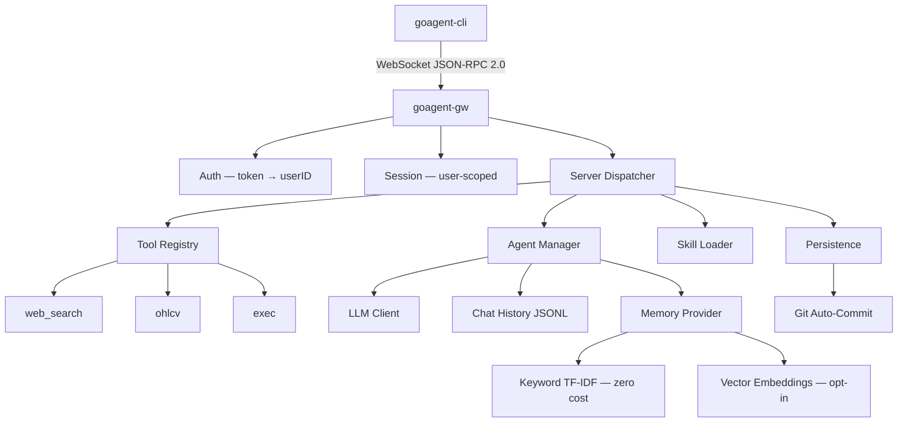
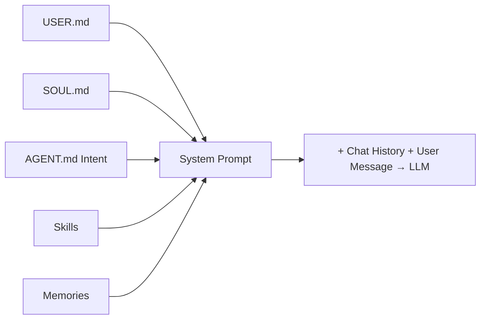
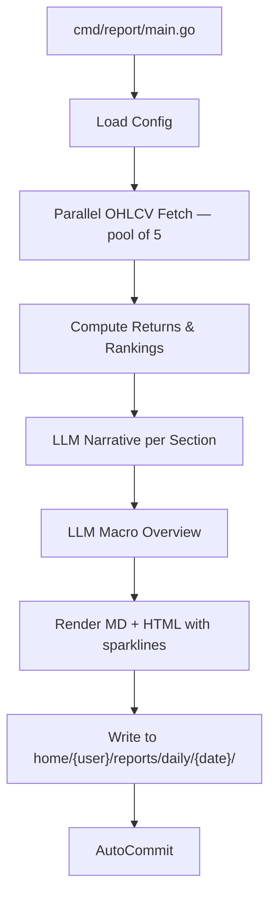

# CLAUDE.md

This file provides guidance to Claude Code (claude.ai/code) when working with code in this repository.

## Build & Test Commands

```bash
make build              # Build bin/goagent-gw, bin/goagent-cli, bin/goagent-report
make test               # Run unit tests (mock only, no API key needed)
make test-integration   # Run all tests including LLM integration (needs .env with LLM_API_KEY)
make run-gw             # Build and start the gateway server
make clean              # Remove build artifacts
```

All `go` commands require `GOTOOLCHAIN=local` prefix (enforced in Makefile). To run a single test:

```bash
GOTOOLCHAIN=local go test ./internal/llm/ -run TestChatCompletion -v
```

Integration tests are prefixed with `TestI` — the `make test` target excludes them via `-run 'Test[^I]'`.

## Architecture

GoAgent is a multi-user WebSocket gateway that routes JSON-RPC 2.0 requests to tools and LLM-powered agents. Three binaries: `goagent-gw` (server), `goagent-cli` (client), and `goagent-report` (daily market report generator).



**Agent chat loop** (`server.go:dispatch`): Assembles system prompt from USER.md + SOUL.md + AGENT.md intent + skills + memories, sends to an OpenAI-compatible LLM, executes tool calls via the tool registry (max 10 rounds), and streams responses. See `MEMORY.md` for the memory/context engineering design.

**Key packages:**
- `internal/server` — Central dispatcher; routes all JSON-RPC methods. This is the main integration point.
- `internal/auth` — Multi-user auth via `users.json` token→userID mapping. Falls back to `"default"` user when no auth configured.
- `internal/llm` — OpenAI-compatible HTTP client with streaming support. Works with DeepSeek, Ollama, OpenAI, Groq, etc.
- `internal/tools` — Tool registry mapping tool names to handler functions + LLM schemas. Tools: `web_search`, `ohlcv`, `exec`. Also exports `FetchBars()` for direct OHLCV access.
- `internal/reporting` — Daily market report pipeline (fetch, compute, narrate, render). Standalone — no WebSocket dependency.
- `internal/agent` — Loads USER.md (global), SOUL.md (per-agent), AGENT.md intent, and manages JSONL conversation history.
- `internal/memory` — Plug-and-play memory via `Provider` interface. Default: zero-cost TF-IDF keyword scorer. Opt-in: vector embeddings when `EMBED_*` env vars are set.
- `internal/skills` — Parses OpenClaw-compatible `SKILL.md` files (YAML frontmatter + markdown). Skills inject instructions into agent prompts. Auto-checks binary/env requirements.
- `internal/persistence` — Atomic file writes via temp+rename, plus debounced git auto-commit (2s delay).
- `internal/session` — Wraps WebSocket connections with user identity and JSONL message logging.

## Multi-User Data Layout

```
~/.goagent/
├── users.json                              ← token → userID mapping
├── skills/                                 ← global, shared by all users
│   └── {skillname}/SKILL.md
├── home/
│   └── {userID}/                           ← user's home directory
│       ├── USER.md                         ← preferences, style — shared by ALL user's agents
│       ├── sessions/
│       │   └── sess-{timestamp}.jsonl
│       ├── config/
│       │   └── daily_report.json          ← report sections & symbols
│       ├── reports/
│       │   └── daily/{YYYY-MM-DD}/
│       │       ├── data.json              ← structured metrics
│       │       ├── market_report.md
│       │       └── market_report.html     ← sparklines + color-coded %
│       └── agents/
│           └── {agentName}/
│               ├── SOUL.md                 ← agent personality, tone
│               ├── {AGENTNAME}.md          ← intent + status
│               └── memory/
│                   ├── chat.jsonl          ← conversation history
│                   └── memories.jsonl      ← long-term memory
```

All state is plain-text (JSON, JSONL, Markdown) designed to be git-tracked. When no `users.json` exists, all connections map to user `"default"`.

## System Prompt Assembly Order



1. **USER.md** — who the user is (global preferences, OS, communication style)
2. **SOUL.md** — who the agent is (personality, tone, behavioral guidelines)
3. **AGENT.md # Intent** — what the agent does (task/domain focus)
4. **Skills** — what tools it has
5. **Memories** — what it remembers (keyword or vector retrieval)

## Daily Market Report

Standalone CLI that generates end-of-day market reports — decoupled from the WebSocket server.

```bash
./scripts/daily-report.sh --user default            # Full run (data + LLM narratives)
./scripts/daily-report.sh --user default --no-llm   # Data pipeline only (no API calls to LLM)
./scripts/daily-report.sh --user john --date 2026-02-14  # Specific date
```

Or directly: `./bin/goagent-report daily [flags]`



**Output** (3 files per run):
```
~/.goagent/home/{userID}/reports/daily/{YYYY-MM-DD}/
├── data.json            ← structured metrics (all symbols, rankings)
├── market_report.md     ← markdown with tables and narratives
└── market_report.html   ← standalone HTML with inline SVG sparklines, color-coded %
```

**Config** at `home/{userID}/config/daily_report.json` — created with defaults on first run. 5 sections: US Mag 7, China Dragons, Macro ETFs, Precious Metals, Crypto. User edits the JSON directly to customize symbols/sections.

**Key packages:**
- `internal/reporting/config.go` — config loading, default section generation
- `internal/reporting/fetch.go` — parallel OHLCV fetching via `tools.FetchBars()`, non-fatal per-range errors
- `internal/reporting/compute.go` — deterministic % change math (1D/5D/1M/YTD), top movers ranking, SVG sparkline generation
- `internal/reporting/narrative.go` — LLM prompt construction for per-section bullets and cross-sector macro overview
- `internal/reporting/render.go` — Go `text/template` for MD, `html/template` for HTML with inline CSS
- `internal/reporting/report.go` — orchestrator tying fetch → compute → narrate → render → write → git

**Cron scheduling** (5:10pm CT on weekdays):
```
10 17 * * 1-5 cd /path/to/goagent && ./scripts/daily-report.sh --user john
```

## Environment Variables

Configured via `.env` file in project root (see `.env.example`). Existing env vars take precedence.

- `LLM_BASE_URL` — Full API prefix for the LLM provider (default: `https://api.deepseek.com/v1`)
- `LLM_API_KEY` — Required for cloud LLM providers
- `LLM_MODEL` — Model name (default: `deepseek-chat`)
- `EMBED_BASE_URL` / `EMBED_API_KEY` / `EMBED_MODEL` — Embedding config (falls back to LLM_* values). When unset, memory uses zero-cost keyword scoring instead.
- `GOAGENT_TOKEN` — WebSocket auth token (auth disabled if unset)
- `BRAVE_SEARCH_API_KEY` / `SEARCH_BACKEND` — Web search configuration

## Conventions

- Single external dependency: `nhooyr.io/websocket`. No frameworks.
- Standard library `testing` package only — no test frameworks.
- All server methods are dispatched through a single `switch` in `internal/server/server.go`.
- Tool handlers accept `json.RawMessage` params and return `(any, error)`.
- The `exec` tool has a safety blocklist for dangerous shell patterns (rm -rf /, mkfs, etc.).
- All data paths flow through user home directories: `home/{userID}/agents/{name}/...`
- Memory backends implement the `Provider` interface (`Load`, `Search`, `Save`, `Count`).
