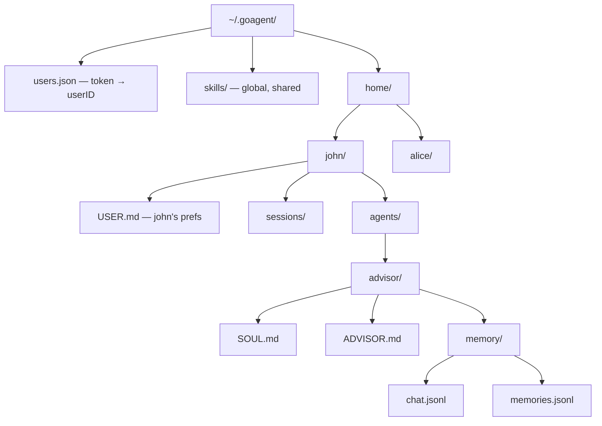
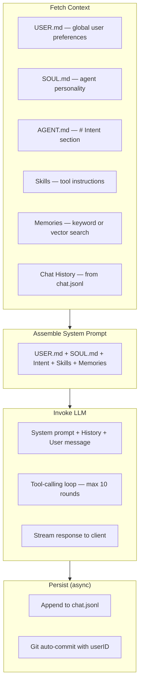
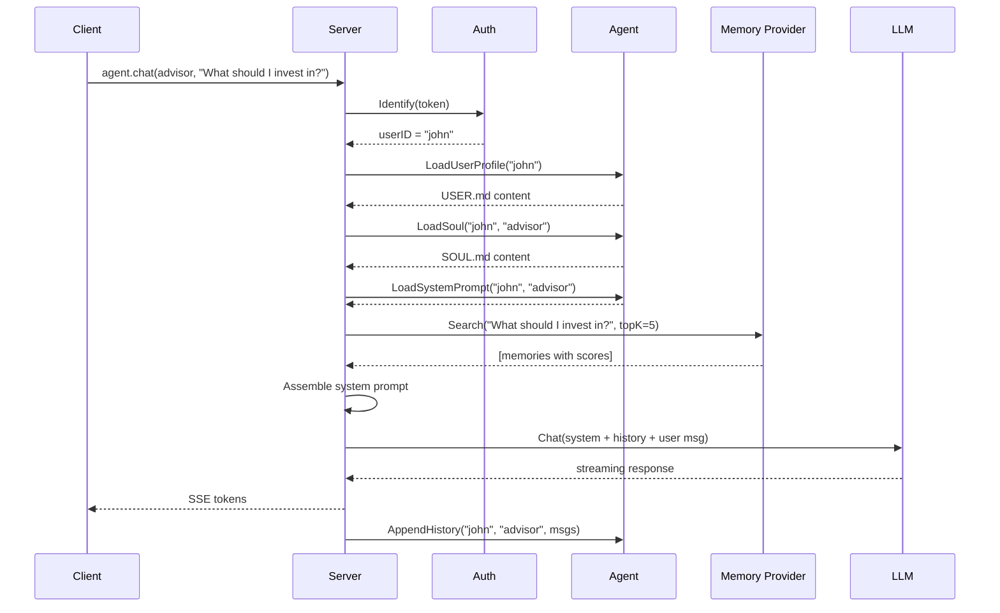
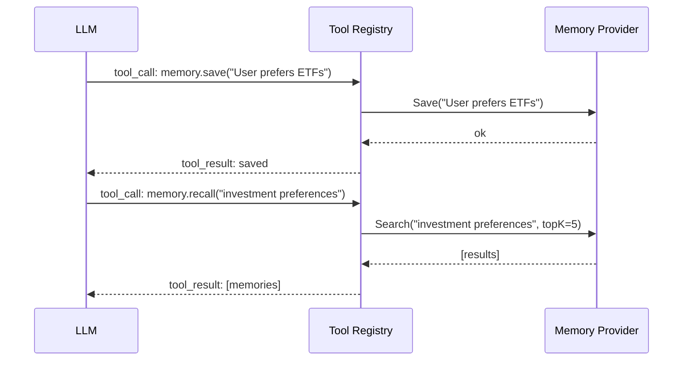
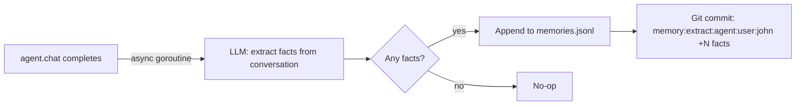
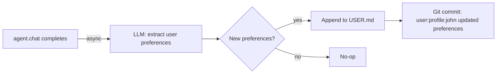
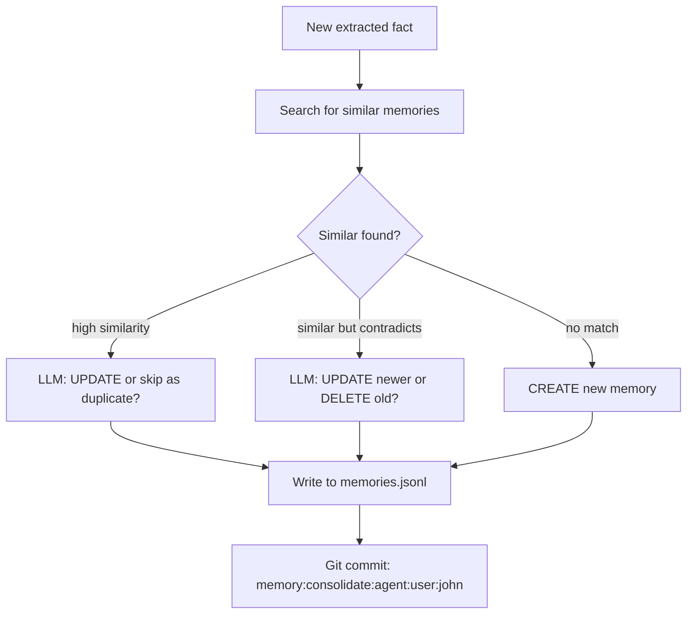
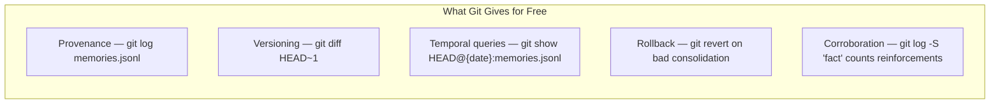

# MEMORY.md

Design document for GoAgent's memory and context engineering subsystem.

Reference: *Context Engineering: Sessions & Memory* (Google, Nov 2025) — `docs/Context Engineering_ Sessions & Memory.pdf`

## Terminology

| Term | GoAgent meaning |
|------|-----------------|
| **Session** | A single WebSocket connection's lifespan. Logged to `home/{userID}/sessions/{id}.jsonl`. |
| **Memory** | Extracted knowledge persisted across sessions in `memories.jsonl`. |
| **Context** | The full payload sent to the LLM: USER.md + SOUL.md + intent + skills + memories + history. |
| **USER.md** | Global user profile shared by all agents. Lives at `home/{userID}/USER.md`. |
| **SOUL.md** | Per-agent personality and behavioral guidelines. Lives at `home/{userID}/agents/{name}/SOUL.md`. |

## Current State

```
                          WIRED INTO
COMPONENT                 agent.chat?   STATUS
─────────────────────────────────────────────────
USER.md (global profile)  Yes           Created on first connect, injected into prompt
SOUL.md (agent persona)   Yes           Created on agent.create, injected into prompt
System prompt (.md)       Yes           Working — # Intent section extracted
Skill injection           Yes           Working
Memory retrieval          Yes           Working — keyword (default) or vector (opt-in)
Chat history (JSONL)      Yes           Working — but unbounded growth
Session logging           Write-only    Never read back
Git auto-commit           Yes           Commits all state changes with userID
```

Memory uses the `Provider` interface with two backends:
- **KeywordStore** (default) — TF-IDF cosine similarity, zero API cost, no dependencies
- **Store** (opt-in) — Vector embeddings via `EMBED_*` env vars, higher accuracy

## Multi-User Data Layout



- **USER.md** is per-user, not per-agent — all of a user's agents share it
- **SOUL.md** is per-agent — each agent has its own personality
- **Skills** are global — shared across all users and agents
- **Memories** are per-agent — scoped to `home/{userID}/agents/{name}/memory/`
- No auth configured → all connections map to user `"default"`

## Context Assembly





## Memory Provider Interface

```go
type Provider interface {
    Load() error
    Search(query string, topK int) ([]SearchResult, error)
    Save(text string) error
    Count() int
}
```

`NewProvider()` auto-selects based on environment:
- `EMBED_BASE_URL` or `EMBED_API_KEY` set → vector `Store`
- Otherwise → zero-cost `KeywordStore` (TF-IDF)

## Remaining Improvements

### No-Brainers

#### 1. Sliding window on chat history

Cap the history sent to the LLM at the last N messages (e.g., 20). Full history stays in `chat.jsonl` — this only affects the context window.

```go
const maxHistoryTurns = 20
if len(history) > maxHistoryTurns {
    history = history[len(history)-maxHistoryTurns:]
}
```

Three lines of code. Prevents unbounded token growth, cost blowup, and context rot.

#### 2. Structured git commit messages

Current commit messages now include userID (`agent:chat:advisor:user:john`). Further improvement — distinguish memory operations:

```
memory:extract:advisor:user:john +3 facts from session abc-123
memory:save:advisor:user:john "User prefers index funds"
agent:chat:advisor:user:john 2026-02-14T10:30:00Z
```

Enables `git log --oneline --grep="memory:" --grep="user:john"` as a first-class observability tool.

### Nice-to-Have — Schedule Later

#### Memory-as-a-Tool

Register `memory.save` and `memory.recall` as tools in the tool registry. The agent decides when to save or search memories.



#### Automatic Memory Extraction

After each `agent.chat` turn, extract facts as a background goroutine.



#### Automatic USER.md Growth

Extract user preferences and style from conversations and append to USER.md. The agent learns "I use Ubuntu 24.04" or "I prefer minimal dependencies" without being told explicitly.



#### Memory Consolidation

Periodically compare new memories against existing ones. LLM decides: **CREATE** (novel), **UPDATE** (refines existing), or **DELETE** (contradicts/superseded).



#### Recursive Summarization

When history exceeds a threshold, summarize older turns into a rolling summary stored at `home/{userID}/agents/{name}/memory/summary.md`. Prefix the summary to recent verbatim history.

#### Blended Retrieval Scoring

Combine cosine similarity + recency + confidence instead of similarity alone. Pure vector search surfaces "conceptually similar but old or trivial" memories.

#### Per-Agent Topic Definitions

Let each agent define what's "worth remembering" in its SOUL.md. A financial advisor extracts different facts than a coding assistant.

## Git as Memory Infrastructure

GoAgent's git-native persistence gives us capabilities most memory systems must build from scratch.



| Need (from whitepaper) | GoAgent's git-native equivalent |
|------------------------|---------------------------------|
| Memory lineage/provenance | `git log -- home/{user}/agents/{name}/memory/memories.jsonl` |
| Version history | `git diff HEAD~1 -- memories.jsonl` |
| "What did the agent know on date X?" | `git show HEAD@{date}:memories.jsonl` |
| Undo bad consolidation | `git revert {commit}` |
| Confidence from corroboration | `git log -S "fact text" \| wc -l` — count sessions that reinforced a fact |
| Time-based decay signal | `git log -1 --format=%aI -- memories.jsonl` — last modification date |
| Per-user audit trail | `git log --grep="user:john"` — all operations for a specific user |

## Design Principles

1. **Background, not blocking** — Memory generation must never delay the agent's response. Goroutines, same as AutoCommit.
2. **Git is the system of record** — Every memory mutation is a commit. Don't rebuild what git provides.
3. **Plain text all the way down** — JSONL, Markdown. Everything is `grep`-able, `jq`-parseable, `git diff`-able.
4. **Memories go in the system prompt** — Gives them authority without polluting dialogue. Use `<MEMORIES>` tags.
5. **User-scoped, agent-isolated** — Each user has a home directory. Each agent has its own memory store. USER.md is shared across agents; memories are not.
6. **Zero cost by default** — Keyword TF-IDF runs in-process with no API calls. Vector embeddings are opt-in for users who want higher accuracy.
7. **USER.md is the user's identity** — Preferences, style, OS, pet peeves. Shared by all agents. Grows over time. Updated once, known everywhere.
